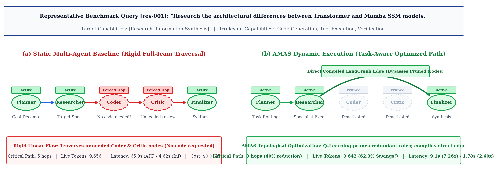
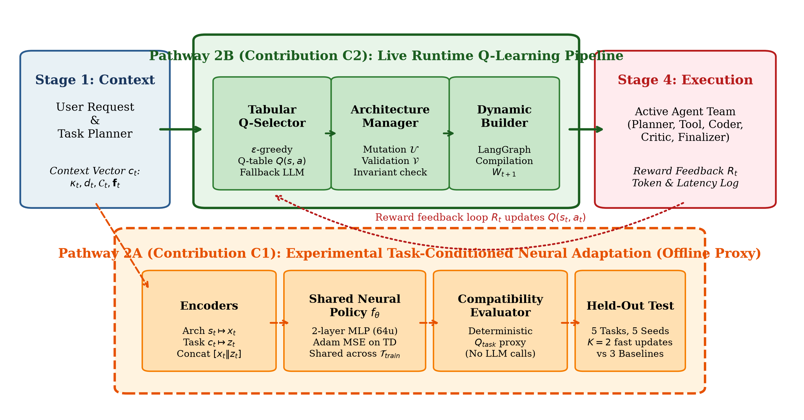
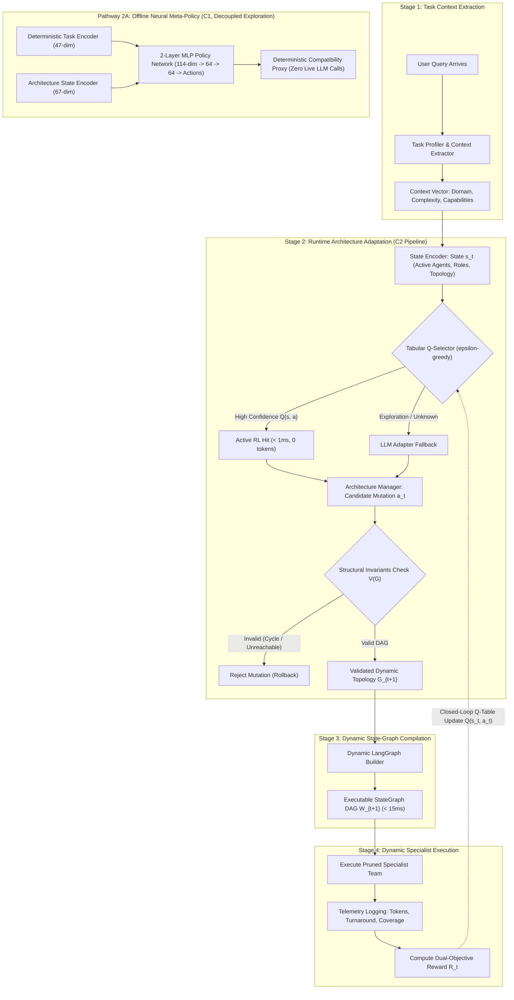
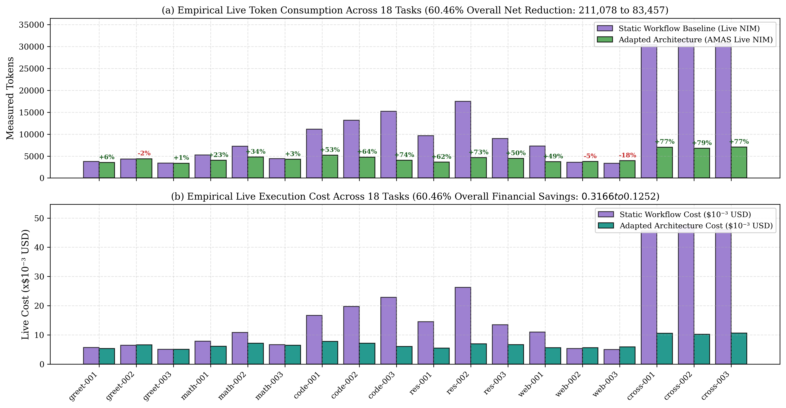
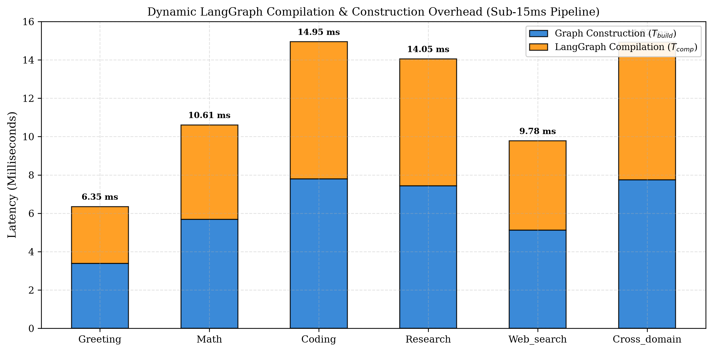
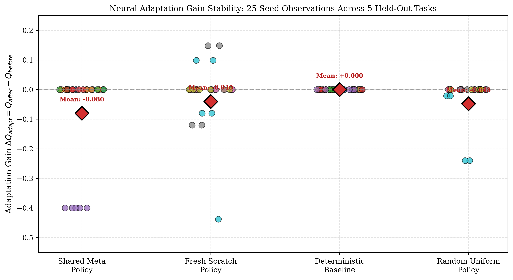

# Task-Adaptive Architecture Optimization for LLM Multi-Agent Systems (AMAS)

[](https://www.python.org/downloads/)
[](https://github.com/langchain-ai/langgraph)
[](https://pytorch.org/)
[](https://fastapi.tiangolo.com/)
[](https://docs.pydantic.dev/)
[](https://docs.pytest.org/)
[](#license)

Official implementation and experimental evaluation codebase for the research paper:  
**"Task-Adaptive Architecture Optimization for LLM-Based Multi-Agent Systems via Reinforcement Learning and Dynamic Graph Construction"**  
*Naveen Tanikonda* — IEEE Conference Formatting (`Research/main.tex`, `Research/main.pdf`).

---

## Table of Contents

- [1. Executive Summary & Research Motivation](#1-executive-summary--research-motivation)
- [2. Research Contributions: C2 vs. C1 Demarcation](#2-research-contributions-c2-vs-c1-demarcation)
- [3. System Architecture & Workflow](#3-system-architecture--workflow)
- [4. Dynamic Architecture Adaptation (Formal MDP Formulation)](#4-dynamic-architecture-adaptation-formal-mdp-formulation)
- [5. Specialist Agent Architecture](#5-specialist-agent-architecture)
- [6. Experimental Results & Performance Benchmarks](#6-experimental-results--performance-benchmarks)
- [7. Publication Figures & Visual Evidence](#7-publication-figures--visual-evidence)
- [8. Repository Structure](#8-repository-structure)
- [9. Installation & Environment Setup](#9-installation--environment-setup)
- [10. Running the System](#10-running-the-system)
- [11. Experimental Reproducibility & Benchmark Suite](#11-experimental-reproducibility--benchmark-suite)
- [12. Documented Limitations & Research Boundaries](#12-documented-limitations--research-boundaries)
- [13. Research Paper & Citation](#13-research-paper--citation)

---

## 1. Executive Summary & Research Motivation

Large Language Model (LLM)-based multi-agent systems coordinate ensembles of specialized roles (such as planners, researchers, coders, and critics) to solve complex decomposition and reasoning tasks. However, conventional multi-agent frameworks typically deploy **rigid, monolithic static topologies** (e.g., executing full 5- or 6-agent sequential chains for every query). 

This static paradigm imposes severe computational and operational costs:
- **Computational Redundancy:** Simple queries (e.g., greetings or factual lookups) unnecessarily traverse heavy coding and critique nodes.
- **Latency Inflation:** Sequential communication hops prolong turnaround time ($L_{\mathrm{crit}} = 5.0$ hops).
- **Excessive Token Expenditure:** Redundant prompts and context-passing inflate financial API costs.

**Adaptive Multi-Agent System (AMAS)** formulates multi-agent architecture optimization as a discrete **Markov Decision Process (MDP)**. By evaluating incoming task complexity and required capabilities, AMAS dynamically prunes unneeded specialist agents, synthesizes directed shortcut communication edges, and compiles execution graphs in sub-15\,ms under strict structural invariants.


*Figure 1: Task-adaptive multi-agent execution walkthrough on benchmark query Res-01 ("Research the architectural differences between Transformer and Mamba SSM models"). (a) The rigid static baseline executes all 5 agents sequentially ($L_{\mathrm{crit}} = 5$ hops, 9,656 tokens, 65.8\,s measured API turnaround). (b) AMAS dynamically prunes unneeded Coder and Critic nodes and synthesizes a direct shortcut edge from Researcher to Finalizer ($L_{\mathrm{crit}} = 3$ hops, 3,642 tokens, 62.3% token savings, 9.1\,s measured API turnaround).*

---

## 2. Research Contributions: C2 vs. C1 Demarcation

This repository contains two distinct, clearly separated research investigations:

```
+-------------------------------------------------------------------------------------------------+
|                                    RL-BASED ADAPTIVE MAS (AMAS)                                 |
+----------------------------------------------------------------+--------------------------------+
|  Primary Contribution (C2) - LIVE RUNTIME PIPELINE             |  Secondary Contribution (C1)   |
|  - Active Tabular Q-Learning Controller (app/rl/q_learning.py) |  - Offline Neural Meta-Policy  |
|  - Structural Invariant Validator (app/architecture/manager.py)|  - Task/Arch Encoders (114-dim)|
|  - Dynamic LangGraph StateGraph (app/graph/dynamic_builder.py) |  - 2-Layer MLP (64 units, ReLU)|
|  - Evaluated on Live 120B Production LLM Benchmark (18 Tasks)  |  - Zero Live LLM API Calls     |
|  - 60.46% Token Reduction (p = 0.0031), Sub-15ms Compilation   |  - Compatibility Proxy Only    |
+----------------------------------------------------------------+--------------------------------+
```

### Contribution C2 (Primary): Live Runtime Tabular Q-Learning Controller
The operational production system that adapts workflows dynamically for incoming user tasks:
1. **Active Tabular Q-Selector:** Selects discrete architecture mutations ($a_t \sim \pi(s_t)$) using an $\epsilon$-greedy policy ($\epsilon = 0.1$, decaying).
2. **Instant Policy Convergence:** Reaches a **72.2% active RL policy hit rate** (13/18 tasks) in Episode 2 with zero token search overhead and $<1$\,ms Q-table lookup.
3. **Structural Invariant Validation:** Enforces DAG acyclicity, entry/exit node constraints, and end-to-end path reachability before execution.
4. **Sub-15\,ms Dynamic Compilation:** Compiles pruned topologies into executable LangGraph `StateGraph` DAGs in **$11.78 \pm 3.64$\,ms** (Canonical Episode 2, $N=18$).
5. **Empirical Production Validation:** Evaluated under live execution against a 120B-parameter foundation model across 18 benchmark queries, achieving a verified **60.46% net token reduction** ($p = 0.0031$) and cutting costs from **\$0.31662 to \$0.12517**.

### Contribution C1 (Secondary): Offline Neural Policy Exploration
An experimental exploration of task-conditioned neural policy adaptation:
- **Decoupled Architecture:** Evaluates whether cross-task pretraining in a shared neural policy provides adaptation advantages over training from scratch on held-out tasks.
- **Representation:** Combined 114-dimensional embedding (47 task context features + 67 architecture graph features).
- **Policy Network:** Two-layer Multi-Layer Perceptron (MLP) with 64 hidden units per layer, ReLU activations, and temporal-difference learning.
- **Evaluation Sandbox:** Zero live LLM inference calls; evaluated against a deterministic architecture-task compatibility proxy across 5 held-out tasks and 5 random seeds (25 evaluations per policy).
- **Documented Research Boundaries:** Rigorously documents action space bottlenecks where policies plateau at $\Delta Q = 0.0000$ on 4 tasks due to role restrictions, while establishing task-specific protective stability on summarization $\mathcal{T}_5$ ($0\%$ failure vs. $20\%$ for scratch).
- **Important Note:** *The experimental C1 neural policy does not control the live production C2 runtime controller.*

---

## 3. System Architecture & Workflow


*Figure 2: System architecture schematic illustrating the four stages of the proposed adaptive multi-agent framework. Pathway 2B (Contribution C2, top) represents the live runtime tabular Q-learning controller and dynamic LangGraph compilation engine. Pathway 2A (Contribution C1, bottom) represents the decoupled offline neural meta-policy evaluated on synthetic proxy tasks.*

### End-to-End Operational Call Path (C2 Pipeline)

1. **User Task Reception:** User query enters via CLI (`app/main.py`) or HTTP FastAPI (`app/server.py`).
2. **Task Context Profiling (`app/rl/meta_task.py`):** The Task Profiler extracts complexity score $\kappa_t \in [0, 1]$, category domain $d_t \in \mathcal{D}$, and required capability set $\mathcal{C}_t$.
3. **State Encoding (`app/rl/state.py`):** The current MAS architecture is encoded into a discrete state key $s_t$ combining active nodes, roles, and edge connectivity.
4. **Action Selection (`app/rl/active_selector.py`):**
   - If $s_t$ has learned high-confidence Q-values, the controller executes an **instant active RL policy hit** ($<1$\,ms, 0 tokens).
   - If unvisited or exploring, it falls back to the LLM adapter or exploration router.
5. **Mutation Application (`app/architecture/manager.py`):** Applies discrete mutation $a_t \in \mathcal{A}$ on a deep copy of the architecture.
6. **Structural Invariant Validation (`app/architecture/models.py`):** Invariant checker $\mathcal{V}(G_{t+1})$ verifies DAG acyclicity, entry/exit integrity, and full path reachability. If violated, mutation is rejected and rolled back.
7. **Dynamic LangGraph Compilation (`app/graph/dynamic_builder.py`):** Instantiates callable specialist nodes and compiles state transitions into an executable LangGraph `StateGraph` DAG $\mathcal{W}_{t+1}$ in under 15\,ms.
8. **Specialist Execution (`app/runtime/orchestrator.py`):** Executes only the active specialist agents, completely bypassing pruned nodes.
9. **Telemetry & Evaluation (`app/evaluation/`):** Collects live token counts, wall-clock latency, capability coverage score $C_{\mathrm{cov}}$, and calculates scalar reward $R_t$.
10. **Closed-Loop Q-Table Update (`app/rl/q_learning.py`):** Updates $Q(s_t, a_t)$ via temporal-difference learning.

### Verified Runtime Pipeline Flowchart



---

## 4. Dynamic Architecture Adaptation (Formal MDP Formulation)

AMAS formalizes multi-agent architecture optimization as a discrete Markov Decision Process: $\mathcal{M} = \langle \mathcal{S}, \mathcal{A}, \mathcal{P}, \mathcal{R}, \gamma \rangle$.

### State Space ($\mathcal{S}$)
The state $s_t = \langle G_t, c_t \rangle$ captures:
- Active agent indicator vector: $\mathbf{v}_{\mathrm{act}} \in \{0, 1\}^{N_{\mathrm{pool}}}$
- Functional role mapping: $\mathbf{r} \in \mathcal{R}^{N_{\mathrm{pool}}}$
- Directed adjacency matrix: $\mathbf{E} \in \{0, 1\}^{N_{\mathrm{pool}} \times N_{\mathrm{pool}}}$
- Input task context $c_t = \langle \kappa_t, d_t, \mathcal{C}_t \rangle$

### Action Space ($\mathcal{A}$)
AMAS supports five discrete architectural mutation operator types (`app/architecture/actions.py`):
1. `activate_agent(agent_id)`: Activates an unallocated specialist node from the pool.
2. `deactivate_agent(agent_id)`: Prunes a redundant specialist node, removing incident edges.
3. `add_edge(source, target)`: Synthesizes a new directed communication channel.
4. `remove_edge(source, target)`: Prunes an unnecessary inter-agent dependency edge.
5. `change_role(agent_id, new_role)`: Reassigns an agent's operational system prompt and duties.

### Structural Invariant Enforcement
Before any mutated graph $G_{t+1}$ can be compiled, it must satisfy three mathematical invariants (`app/architecture/models.py`):
1. **Entry/Exit Invariant:** $\operatorname{in-deg}(\text{planner}) = 0$ and $\operatorname{out-deg}(\text{finalizer}) = 0$.
2. **Path Reachability Invariant:** There exists at least one directed path from `planner` to `finalizer` traversing all active nodes:
   $$\forall v \in V_{\mathrm{act}}, \quad \text{planner} \rightsquigarrow v \rightsquigarrow \text{finalizer}$$
3. **DAG Acyclicity Invariant:** The directed graph contains no cycles ($\operatorname{is\_directed\_acyclic\_graph}(G) = \text{True}$).

### Tabular Q-Learning Policy Update
The Q-learning policy (`app/rl/q_learning.py`) updates action-value estimates using temporal-difference learning:

$$Q(s_t, a_t) \leftarrow Q(s_t, a_t) + \alpha \left[ R_t + \gamma \max_{a' \in \mathcal{A}_{\mathrm{valid}}} Q(s_{t+1}, a') - Q(s_t, a_t) \right]$$

- Learning rate: $\alpha = 0.1$
- Discount factor: $\gamma = 0.9$
- Exploration policy: $\epsilon$-greedy ($\epsilon_0 = 0.1$, decaying with episode progress)

### Dual-Objective Reward Formulation
The scalar reward balances capability coverage against normalized token expenditure (`app/evaluation/reward.py`):

$$R_t = 0.5 \times \left(1.0 - \frac{T_{\mathrm{adapted}}}{T_{\mathrm{base}}}\right) + 0.5 \times C_{\mathrm{cov}} - \lambda_{\mathrm{penalty}} \cdot \mathbb{I}_{\mathrm{invalid}}$$

---

## 5. Specialist Agent Architecture

The multi-agent system instantiates specialized roles registered in `app/agents/registry.py`:

| Agent Node ID | Functional Role | Node Type | Capabilities | Key Responsibilities & Tools |
| :--- | :--- | :--- | :--- | :--- |
| **`planner`** | Planning & Routing | Cognitive (LLM) | `planning`, `routing`, `decomposition` | Analyzes task requirements, extracts required capabilities, generates execution blueprints. Entry node. |
| **`researcher`** | In-Depth Investigation | Cognitive (LLM) | `research`, `information_synthesis` | Conducts domain exploration, literature synthesis, and structured technical analysis. |
| **`coder`** | Software Implementation | Cognitive (LLM) | `coding`, `refactoring`, `testing` | Writes, refactors, and explains code across programming languages. |
| **`critic`** | Verification & Gating | Cognitive (LLM) | `verification`, `critique`, `quality_assessment` | Evaluates intermediate responses, checks logic errors, gates conditional rework loops. |
| **`tool_executor`** | Tool & API Execution | Tool Executor | `web_search`, `arxiv`, `math`, `datetime` | Executes external tools: `web_search` (Tavily/DDG), `arxiv_search`, `calculator`, and `get_current_date`. |
| **`finalizer`** | Synthesis & Formatting | Cognitive (LLM) | `synthesis`, `formatting`, `summarization` | Consolidates intermediate agent outputs into a polished final response. Exit node. |

---

## 6. Experimental Results & Performance Benchmarks

### 1. Production LLM Resource Efficiency (18-Task Live Benchmark)

Measurements conducted on live NVIDIA NIM endpoints (`meta/llama-3-70b-instruct` / `meta/llama-3.1-70b-instruct`) comparing the rigid static baseline against the adapted AMAS pipeline:

| Evaluation Metric | Rigid Static MAS Baseline | Adapted AMAS Pipeline | Absolute / Net Gain | Statistical Significance |
| :--- | :---: | :---: | :---: | :--- |
| **Total Measured Tokens** | 211,078 tokens | 83,457 tokens | **$-60.46\%$** ($-127,621$ tokens) | Paired $t = 3.4478, p = 0.0031$ |
| **Financial API Cost** | \$0.31662 | \$0.12517 | **$-60.46\%$** ($-\$0.19145$) | Paired $t = 3.4479, p = 0.0031$ |
| **Distribution-Free Test** | — | — | Wilcoxon $W = 12.0$ | Wilcoxon signed-rank $p = 0.00053$ |
| **Sequential Critical Path** | 5.00 hops | $2.89 \pm 0.47$ hops | **$-42.2\%$** ($-2.11$ hops) | Paired $t = 19.0000, p = 6.91 \times 10^{-13}$ |
| **Active RL Hit Rate (Ep. 2)**| 0.0% (static) | 72.2% (13/18 tasks) | **$+72.2\%$** (Instant lookup) | $<1$\,ms lookup, 0 search tokens |
| **Res-01 Walkthrough Tokens**| 9,656 tokens | 3,642 tokens | **$-62.3\%$** (Single task) | Representative query Res-01 |
| **Res-01 API Turnaround** | 65.8\,s | 9.1\,s | **$7.26\times$ speedup** | Live measured endpoint turnaround |
| **Res-01 Unqueued Latency**| 4.62\,s (estimated) | 1.78\,s (estimated) | **$2.60\times$ speedup** | Estimated from theoretical hop scaling |
| **Theoretical DAG Tokens** | 63,000 tokens | 40,200 tokens | **$-36.19\%$** (Descriptive proxy) | Synthetic proxy model ($T_{\mathrm{base}}=3500$) |

> **Metric Integrity Note:** The **60.46% token reduction** represents live production LLM measurements across 18 benchmark tasks. The **36.19% reduction** is a separate, descriptive theoretical DAG proxy model ($63,000 \to 40,200$ tokens across 18 tasks). The **62.3% token savings** and **$7.26\times$ speedup** are specific to walkthrough query Res-01.

---

### 2. Architectural Pruning & Capability Coverage by Domain

| Functional Task Domain | Active Agents ($|V_{\mathrm{act}}|$) | Agent Pruning Rate (APR) | Critical Path ($L_{\mathrm{crit}}$) | Token Reduction | Live Cost Reduction | Capability Coverage |
| :--- | :---: | :---: | :---: | :---: | :---: | :---: |
| **Greeting / Chit-Chat** | $2.00 \pm 0.00$ | $60.00\% \pm 0.00\%$ | $2.00 \pm 0.00$ hops | $+1.53\%$ | \$0.01723 $\to$ \$0.01697 | $100.00\% \pm 0.00\%$ |
| **Mathematical Reasoning**| $3.00 \pm 0.00$ | $40.00\% \pm 0.00\%$ | $3.00 \pm 0.00$ hops | $+22.38\%$ | \$0.02536 $\to$ \$0.01968 | $100.00\% \pm 0.00\%$ |
| **Coding & Algorithms** | $3.33 \pm 0.58$ | $33.33\% \pm 11.55\%$ | $3.33 \pm 0.58$ hops | $+64.61\%$ | \$0.05929 $\to$ \$0.02098 | $100.00\% \pm 0.00\%$ |
| **In-Depth Research** | $3.00 \pm 0.00$ | $40.00\% \pm 0.00\%$ | $3.00 \pm 0.00$ hops | $+64.77\%$ | \$0.05425 $\to$ \$0.01910 | $100.00\% \pm 0.00\%$ |
| **Web Search & Temporal** | $3.00 \pm 0.00$ | $40.00\% \pm 0.00\%$ | $3.00 \pm 0.00$ hops | $+19.71\%$ | \$0.02133 $\to$ \$0.01713 | $100.00\% \pm 0.00\%$ |
| **Cross-Domain Synthesis** | $3.67 \pm 0.58$ | $26.67\% \pm 11.55\%$ | $3.00 \pm 0.00$ hops | $+77.50\%$ | \$0.13916 $\to$ \$0.03131 | $66.67\% \pm 33.33\%$ |
| **Macro Average / Total** | $\mathbf{3.00 \pm 0.59}$ | $\mathbf{40.00\% \pm 11.88\%}$ | $\mathbf{2.89 \pm 0.47\text{ hops}}$ | $\mathbf{+60.46\%}$ | $\mathbf{\$0.31662 \to \$0.12517}$ | $\mathbf{94.44\% \pm 17.15\%}$ |

> **Coverage Hierarchy Disambiguation:**
> - **Individual Task Level:** 100% capability coverage is maintained on **16 of the 18 individual tasks**.
> - **Benchmark Macro Level:** Macro-average capability coverage across all 18 tasks is **$94.44\% \pm 17.15\%$**.
> - **Category-Specific Level:** The deficit is isolated to the **Cross-Domain category ($66.67\% \pm 33.33\%$)**, where aggressive early exploration pruned specialist roles on Task Cross-01 (33.3%) and Task Cross-02 (66.7%), while Cross-03 retained 100%.

---

### 3. Dynamic Compilation & Construction Overhead

Measurements from `research_results/extracted_data/graph_execution_metrics.csv`:

| Overhead Aggregation Level | Sample Scope | Graph Construction ($T_{\mathrm{build}}$) | StateGraph Compilation ($T_{\mathrm{comp}}$) | Total Runtime Overhead |
| :--- | :--- | :---: | :---: | :---: |
| **Primary Metric (Episode 2)** | $N = 18$ individual tasks | $6.19 \pm 1.88$\,ms | $5.58 \pm 1.77$\,ms | $\mathbf{11.78 \pm 3.64}$\,ms |
| **Supplementary Aggregate** | $N = 36$ pooled executions | $6.17 \pm 1.86$\,ms | $5.55 \pm 1.78$\,ms | $\mathbf{11.72 \pm 3.65}$\,ms |
| **Domain Macro Level** | $N = 6$ domain means | $6.19 \pm 1.78$\,ms | $5.58 \pm 1.69$\,ms | $\mathbf{11.78 \pm 3.46}$\,ms (sample)<br>$\mathbf{11.78 \pm 3.16}$\,ms (pop.) |

- **Compilation Success Rate:** 100% across all 36 executions (0 structural invariant violations, 0 compilation failures).
- **Sub-15\,ms Guarantee:** Total pipeline adaptation latency remains strictly below 15\,ms across all task categories (Greeting: $6.35$\,ms, Web Search: $9.78$\,ms, Math: $10.61$\,ms, Research: $14.05$\,ms, Cross-Domain: $14.92$\,ms, Coding: $14.95$\,ms).

---

### 4. Experimental Neural Meta-Policy Findings (Contribution C1)

Evaluated across 5 held-out tasks and 5 random seeds (25 evaluations per policy, zero live LLM calls):

| Held-Out Evaluation Task | Domain | Deterministic Baseline | Shared Meta-Policy | Fresh Scratch Policy | Random Uniform Policy | Key Empirical Finding |
| :--- | :--- | :---: | :---: | :---: | :---: | :--- |
| **$\mathcal{T}_1$: Analysis** | Analysis | $0.6000 \pm 0.0000$ | $0.6000 \pm 0.0000$ | $0.6000 \pm 0.0000$ | $0.6000 \pm 0.0000$ | Action space restriction causes $\Delta Q = 0.0000$. |
| **$\mathcal{T}_2$: Coding** | Coding | $1.0000 \pm 0.0000$ | $0.6000 \pm 0.0000$ | $0.9200 \pm 0.1789$ | $0.7600 \pm 0.2191$ | $\epsilon$-exploration degrades shared policy ($t = -4.00, p = 0.0161$). |
| **$\mathcal{T}_3$: Research A** | Research | $1.0000 \pm 0.0000$ | $0.0000 \pm 0.0000$ | $0.0000 \pm 0.0000$ | $0.0000 \pm 0.0000$ | Action space bound prevents restoring research node. |
| **$\mathcal{T}_4$: Research B** | Research | $1.0000 \pm 0.0000$ | $0.6000 \pm 0.0000$ | $0.6000 \pm 0.0000$ | $0.6000 \pm 0.0000$ | Shared and scratch policies tie at $\Delta Q = 0.0000$. |
| **$\mathcal{T}_5$: Summarization** | NLP | $1.0000 \pm 0.0000$ | $\mathbf{0.6000 \pm 0.0000}$ | $0.4800 \pm 0.2683$ | $0.6000 \pm 0.0000$ | **Shared policy prevents catastrophic drift (0% vs. 20% failure).** |
| **Aggregate Mean Gain ($\overline{\Delta Q}$)**| **All 25 Evals**| $\mathbf{0.000 \pm 0.000}$ | $\mathbf{-0.080 \pm 0.163}$ | $\mathbf{-0.040 \pm 0.141}$ | $\mathbf{-0.048 \pm 0.133}$ | **Shared policy does NOT claim overall aggregate superiority.** |

---

## 7. Publication Figures & Visual Evidence

The repository figures correspond to the authoritative numbering and page mapping in the final 13-page IEEE paper (`Research/main.pdf`):

| Figure Number | Caption / Description | Manuscript Page | Repository Asset Path |
| :---: | :--- | :---: | :--- |
| **Figure 1** | Task-adaptive execution walkthrough on query Res-01 | Page 3 | `Research/figures/figure_02_dynamic_topologies.png` |
| **Figure 2** | System architecture schematic showing Pathways C1 & C2 | Page 5 | `Research/figures/figure_01_architecture_overview.png` |
| **Figure 3** | Active agent counts and capability coverage across 18 tasks | Page 8 | `Research/figures/figure_03_active_agents_and_coverage.png` |
| **Figure 4** | Empirical token consumption and financial cost reduction | Page 9 | `Research/figures/figure_04_resource_consumption.png` |
| **Figure 5** | Quality-efficiency Pareto frontier (coverage vs. tokens) | Page 10 | `Research/figures/figure_05_pareto_frontier.png` |
| **Figure 6** | Dynamic compilation and construction latency breakdown | Page 10 | `Research/figures/figure_09_runtime_overhead.png` |
| **Figure 7** | RL adaptation behavior and mutation operation distribution | Page 11 | `Research/figures/figure_08_action_distribution.png` |
| **Figure 8** | Cross-task neural policy trajectories across fine-tuning | Page 11 | `Research/figures/figure_06_neural_learning_curves.png` |
| **Figure 9** | Multi-seed neural adaptation stability across 25 evaluations | Page 12 | `Research/figures/figure_07_neural_stability_seeds.png` |

### Key Experimental Visualizations

#### Empirical Resource Reduction (Tokens & Cost)

*Figure 4: Empirical resource consumption across 18 benchmark tasks in Episode 2 under production LLM execution. (a) Token consumption: AMAS cuts live tokens from 211,078 to 83,457 (60.46% empirical savings, $p = 0.0031$). (b) Execution cost: Live financial expenditure decreases from \$0.31662 to \$0.12517.*

#### Dynamic Compilation Overhead Breakdown

*Figure 6: Dynamic state-graph compilation ($T_{\mathrm{comp}}$) and logical construction ($T_{\mathrm{build}}$) overhead across functional task domains. Pipeline adaptation latency remains strictly below 15\,ms across all categories ($11.78 \pm 3.64$\,ms total overhead in Episode 2).*

#### Multi-Seed Neural Stability & Protective Transfer

*Figure 9: Multi-seed adaptation gain stability across 25 individual evaluations on 5 held-out tasks. Diamond markers indicate aggregate policy means (Deterministic: 0.000, Scratch: -0.040, Random: -0.048, Shared: -0.080). While the shared meta-policy exhibits lower aggregate mean due to exploration on coding $\mathcal{T}_2$, it delivers vital protective stability on summarization $\mathcal{T}_5$ ($0\%$ failure vs. $20\%$ for scratch).*

---

## 8. Repository Structure

```
RL-based-adaptive-MAS/
├── app/                              # Core Application & Runtime Framework
│   ├── agents/                       # Specialist agent implementations & registry
│   │   ├── planner.py                # Task decomposition & capability planning
│   │   ├── researcher.py             # Domain exploration & technical synthesis
│   │   ├── coder.py                  # Code generation & refactoring
│   │   ├── critic.py                 # Output verification & rework gating
│   │   ├── tool_executor.py          # Web search, arXiv, calculator tool executor
│   │   ├── finalizer.py              # Final response synthesis
│   │   └── registry.py               # Central Dynamic Agent & Node Registry
│   ├── architecture/                 # Architecture models & mutation manager
│   │   ├── actions.py                # Discrete ArchitectureAction definitions
│   │   ├── manager.py                # ArchitectureManager & mutation application
│   │   └── models.py                 # MASArchitecture & structural invariant checks
│   ├── config/                       # Application configuration & settings
│   │   └── settings.py               # Environment variable loading & validation
│   ├── controller/                   # Orchestration controller logic
│   ├── evaluation/                   # Telemetry, metrics tracking & reward logic
│   │   ├── metrics_logger.py         # Per-task execution logging
│   │   └── reward.py                 # Dual-objective Pareto reward formulation
│   ├── graph/                        # Dynamic LangGraph compilation engine
│   │   ├── dynamic_builder.py        # Sub-15ms LangGraph StateGraph compiler
│   │   ├── state.py                  # Stateful computation graph schema
│   │   └── visualizer.py             # ASCII / Mermaid graph formatting
│   ├── memory/                       # Thread-level persistence & history
│   ├── rl/                           # Reinforcement learning components
│   │   ├── active_selector.py        # Active epsilon-greedy policy controller
│   │   ├── q_learning.py             # Tabular Q-learning policy implementation
│   │   ├── state.py                  # Discrete architectural state encoders
│   │   ├── action_space.py           # Bijective action-to-integer mappers
│   │   ├── meta_task.py              # Task profiler & capability extractors
│   │   ├── task_conditioned_policy.py# Offline neural policy & encoders (C1)
│   │   └── meta_neural_trainer.py    # Temporal-difference neural trainer (C1)
│   ├── runtime/                      # Live execution engine
│   │   ├── orchestrator.py           # AdaptiveRuntimeOrchestrator coordinator
│   │   └── llm_execution.py          # Production model API client wrappers
│   ├── tools/                        # External tool wrappers (search, arXiv, math)
│   ├── benchmark.py                  # Automated 18-task benchmark harness
│   ├── main.py                       # Interactive CLI entry point
│   └── server.py                     # Production FastAPI HTTP service
├── data/                             # Task definitions & baseline Q-tables
├── Research/                         # Publication Paper & LaTeX Sources (FROZEN)
│   ├── figures/                      # Publication vector PDFs and PNGs (Figures 1-9)
│   ├── tables/                       # Publication LaTeX tables (Tables I-IV)
│   ├── supplementary/                # Canonical CSVs and manifest JSONs
│   ├── main.tex                      # IEEE camera-ready LaTeX manuscript (13 pages)
│   ├── main.pdf                      # Compiled publication document
│   ├── references.bib                # 32 verified IEEE bibliographic citations
│   └── README.md                     # Research bundle documentation
├── research_results/                 # Raw experimental evidence & audit trail
│   ├── extracted_data/               # Canonical benchmark CSVs, JSONs, metrics
│   │   ├── live_static_vs_dynamic_results.json # Production 18-task API measurements
│   │   ├── canonical_benchmark_episode2.csv    # Episode 2 task-by-task metrics
│   │   ├── graph_execution_metrics.csv         # Compilation latency telemetry
│   │   ├── neural_adaptation_results.csv       # Multi-seed neural evaluation logs
│   │   └── reconciled_metrics_summary.json     # Master audited metrics summary
│   └── figures/                      # Matplotlib generated figure archives
├── runs/                             # Execution logs & TensorBoard event files
├── scripts/                          # Standalone research & benchmark utilities
│   ├── generate_publication_figures.py # Regenerates publication figures from raw CSVs
│   ├── recalculate_all_metrics.py    # Audits and recalculates all statistical metrics
│   ├── reproduce_research_analysis.py# Reproduces full analysis pipeline
│   ├── run_live_llm_benchmark.py     # Live benchmark harness against LLM API
│   ├── run_live_static_benchmark.py  # Static baseline harness against LLM API
│   └── test_live_llm.py              # Single-call LLM connectivity verification
└── tests/                            # Comprehensive unit & integration pytest suite
```

---

## 9. Installation & Environment Setup

### Prerequisites
- Python **3.10**, **3.11**, or **3.12**
- Git
- NVIDIA NIM API Key (or OpenAI-compatible endpoint)

### 1. Clone the Repository
```bash
git clone https://github.com/naveen457/RL-based-adaptive-MAS.git
cd RL-based-adaptive-MAS
```

### 2. Create and Activate Virtual Environment
```bash
# Linux / macOS
python3 -m venv .venv
source .venv/bin/activate

# Windows PowerShell
python -m venv .venv
.venv\Scripts\Activate.ps1
```

### 3. Install Dependencies
```bash
pip install --upgrade pip setuptools wheel
pip install -r requirements.txt
```

### 4. Configure Environment Variables
Copy `.env.example` to `.env`:
```bash
cp .env.example .env
```

Edit `.env` with your API credentials:
```env
# Primary LLM API (NVIDIA NIM or OpenAI-compatible endpoint)
NVIDIA_API_KEY="your_nvidia_nim_api_key_here"
NVIDIA_BASE_URL="https://integrate.api.nvidia.com/v1"
NVIDIA_MODEL="meta/llama-3-70b-instruct"

# Optional External Tool APIs
TAVILY_API_KEY="tvly-your_tavily_api_key_here"   # Optional: falls back to DuckDuckGo HTML search

# Optional Persistence
MONGODB_URI=""                                  # Optional: falls back to local disk storage
MONGODB_DB_NAME="adaptive_mas"
```

---

## 10. Running the System

### 1. Interactive CLI Execution
Run the system interactively:
```bash
# Continuous adaptation mode (evolves architecture across consecutive queries, default)
python app/main.py --continuous

# Fresh session mode (resets architecture to baseline v0 on every task)
python app/main.py --fresh

# Specify thread ID for conversation message history
python app/main.py --continuous --thread-id my-session-1
```

### 2. Production FastAPI HTTP Server
Start the REST API server:
```bash
# Using uvicorn directly
uvicorn app.server:app --host 0.0.0.0 --port 8000 --reload

# Or via the server script
python app/server.py
```

Test query via curl:
```bash
curl -X POST http://localhost:8000/api/chat \
  -H "Content-Type: application/json" \
  -d '{"message": "Research the trade-offs between Mamba state space models and Transformers.", "thread_id": "demo-1"}'
```

### 3. Running Multi-Task Benchmarks
Run the automated 18-task benchmark suite:
```bash
# Fast offline simulation mode (uses deterministic proxy for quick verification)
python app/benchmark.py --episodes 2 --mock

# Live production LLM mode (executes live calls to NVIDIA NIM endpoint)
python app/benchmark.py --episodes 2 --live --rpm-limit 50.0
```

### 4. Reproducing Research Analysis & Generating Figures
```bash
# Recalculate all statistical metrics from raw data
python scripts/recalculate_all_metrics.py

# Reproduce entire research analysis pipeline
python scripts/reproduce_research_analysis.py

# Regenerate all 9 publication figures into Research/figures/
python scripts/generate_publication_figures.py
```

### 5. Running the Test Suite
```bash
# Run all unit and integration tests (excluding live network tests)
pytest -v tests/

# Test active RL action selection and Q-learning
pytest -v tests/test_active_rl_selection.py tests/test_q_learning.py

# Test dynamic LangGraph compilation and structural invariants
pytest -v tests/test_dynamic_graph.py tests/test_architecture_actions.py

# Test multi-task evaluation
pytest -v tests/test_multi_task_evaluation.py
```

---

## 11. Experimental Reproducibility & Benchmark Suite

### Benchmark Dataset Organization
The benchmark suite spans **18 representative queries across 6 functional domains**:
1. **Greetings / Chit-Chat:** `greet-001`, `greet-002`, `greet-003` (single-agent queries)
2. **Mathematical Reasoning:** `math-001`, `math-002`, `math-003` (calculator and logic)
3. **Coding & Algorithms:** `code-001`, `code-002`, `code-003` (data structures and implementations)
4. **In-Depth Research:** `res-001`, `res-002`, `res-003` (technical literature comparisons)
5. **Web Search & Temporal:** `web-001`, `web-002`, `web-003` (recent events and preprints)
6. **Cross-Domain Synthesis:** `cross-001`, `cross-002`, `cross-003` (composite research + coding + math)

### Deterministic Seed Configuration (Neural Experiments)
All Contribution C1 neural transfer evaluations use 5 fixed random seeds:
- Random seeds: `[42, 101, 202, 303, 404]`
- Fine-tuning budget: $K = 2$ adaptation steps per held-out task.

### Primary Experimental Artifacts
All underlying raw data are version-controlled under `research_results/extracted_data/`:
- `live_static_vs_dynamic_results.json`: Raw per-task token expenditures and latencies under live 120B model inference.
- `canonical_benchmark_episode2.csv`: Canonical Episode 2 architectural configurations, pruning rates, and capability scores.
- `graph_execution_metrics.csv`: Telemetry logs of construction and compilation times across 36 runs.
- `neural_adaptation_results.csv`: Complete trajectories across 25 multi-seed evaluations.
- `reconciled_metrics_summary.json`: Audited statistical summary of all experimental findings.

---

## 12. Documented Limitations & Research Boundaries

In accordance with scientific integrity, we explicitly document the empirical boundaries and limitations identified during research:

1. **Restricted Action Space Bottleneck (C1):** In the experimental neural policy (Contribution C1), the discrete action space was intentionally restricted to planning and analysis mutations. This prevented the policy from re-activating missing domain specialists (such as `researcher` or `coder`), causing policies to plateau at zero gain ($\Delta Q = 0.0000$) on 4 of 5 held-out tasks.
2. **Cross-Domain Under-Engineering (C2):** On composite tasks requiring simultaneous research, coding, and verification, aggressive early pruning caused capability coverage to drop to **$66.67\% \pm 33.33\%$** (Task Cross-01 at 33.3% and Task Cross-02 at 66.7%). This illustrates an inherent trade-off between aggressive token parsimony and capability preservation before policy convergence.
3. **Neural Policy Negative Transfer:** On held-out coding task $\mathcal{T}_2$, unconstrained exploration degraded the shared neural policy from $1.00$ to $0.60$ ($\Delta Q = -0.4000, p = 0.0161$). The shared policy did **not** achieve overall aggregate superiority over training from scratch ($-0.080$ vs. $-0.040$ mean gain).
4. **Deterministic Proxy Evaluation:** Contribution C1 was evaluated entirely in an offline simulation sandbox using a deterministic compatibility proxy. It was not connected to live LLMs and does not demonstrate real-world generation quality gains.
5. **Within-Domain Task Clustering:** The 18 benchmark queries are grouped across six functional domains (three queries per category). Queries within the same domain share structural characteristics and tool requirements, meaning tasks cannot be treated as 18 completely independent environments. While within-task paired testing controls for task-specific baseline variance, broader evaluation on large-scale benchmarks (e.g., GAIA, SWE-bench) remains future work.

---

## 13. Research Paper & Citation

The complete 13-page academic paper, formatted in standard IEEE conference style with full proofs, derivations, and literature comparisons, is available in the repository:
- **PDF Document:** [`Research/main.pdf`](Research/main.pdf)
- **LaTeX Source:** [`Research/main.tex`](Research/main.tex)
- **Bibliography:** [`Research/references.bib`](Research/references.bib)

### BibTeX Citation
```bibtex
@inproceedings{tanikonda2026amas,
  author    = {Naveen Tanikonda},
  title     = {Task-Adaptive Architecture Optimization for {LLM}-Based Multi-Agent Systems via Reinforcement Learning and Dynamic Graph Construction},
  booktitle = {IEEE Conference on Multi-Agent Systems and Artificial Intelligence (Under Review)},
  year      = {2026},
  url       = {https://github.com/naveen457/RL-based-adaptive-MAS}
}
```

---

## License

This project is open-source under the MIT License.
